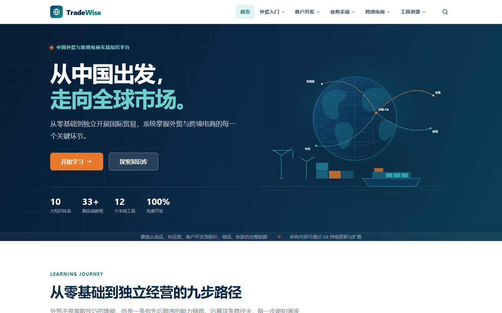
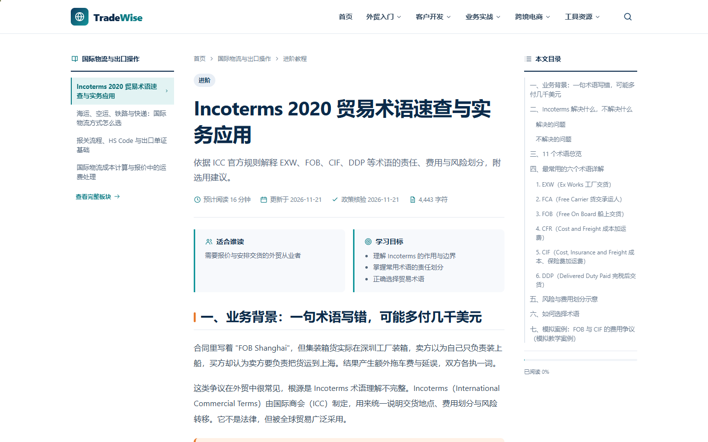
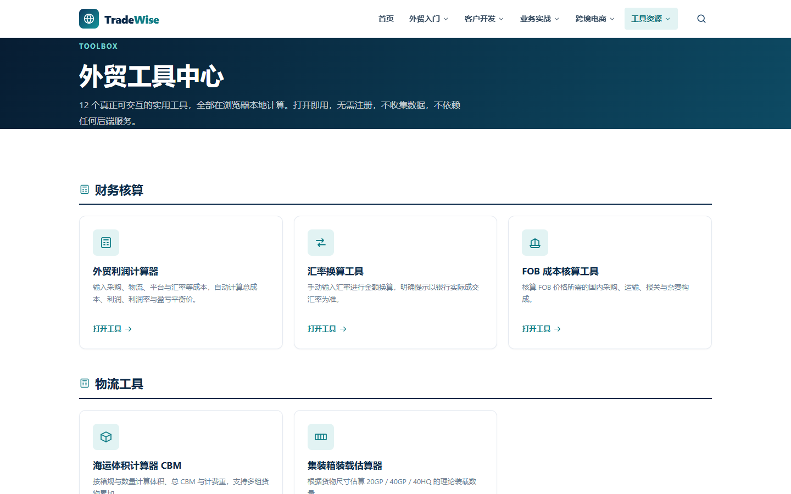
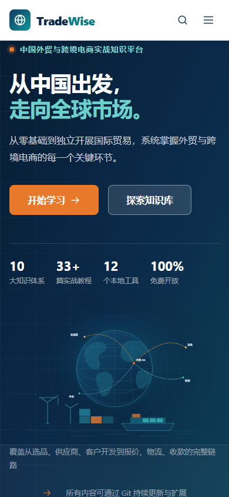

# TradeWise 外贸实战学院

> Learn Trade. Build Business. Go Global.
>
> 从中国出发，走向全球市场。

TradeWise 是一个面向中国外贸零基础创业者、外贸业务员、SOHO 从业者、跨境电商卖家与中小企业的实战知识平台。目标是让一个完全没有外贸经验的新手，能够沿着清晰路径学习选品、供应商、市场研究、客户开发、询盘报价、签约、物流、收款与跨境运营，最终独立开展国际贸易业务。

**最终访问地址：** https://yuxinrun.github.io/tradewise/

---

## 一、网站截图

以下截图均来自本地实际运行的网站（`npm run dev`），未使用设计稿或虚构图片。

### 首页（桌面端 1440px）



### 文章详情页（三栏阅读布局 + 目录 + 阅读进度）



### 工具中心



### 手机端首页（390px）



---

## 二、项目定位

这不是一个简单博客或卡片展示模板，而是一套**可学习、可操作、可持续扩展**的知识系统：

- **系统性**：十大知识板块覆盖从认知外贸到公司化经营的全链路。
- **路径化**：九步学习路径与 30 天入门计划，让新手知道「下一步学什么」。
- **深度内容**：34 篇中文教程，每篇包含业务背景、操作步骤、常见错误、风险提示、案例、模板、FAQ 与官方参考。
- **真实可用**：12 个浏览器本地运行的工具与 13 个可下载模板。
- **合规审慎**：Incoterms 以 ICC 规则为准；政策、平台规则标注核验日期；案例明确标注类型；不编造数据与收费。

## 三、已实现功能

| 模块 | 说明 |
| --- | --- |
| 独立设计的首页 | Hero 全球贸易 SVG 主视觉、学习路径、十大板块、30 天入门、热门教程、工具、案例、最新文章 |
| 十大知识板块 | 分类首页、学习目标、阅读顺序、入门/进阶/实战文章、相关工具与模板 |
| 文章系统 | 三栏布局、左侧知识目录、右侧 TOC、阅读进度、难度标识、上一篇/下一篇、相关文章、代码复制、FAQ 折叠 |
| 30 天入门计划 | 每日学习 + 实践任务，本地保存完成进度，阶段筛选 |
| 全站搜索 | 本地索引，搜索标题/摘要/正文/分类/工具/模板，关键词高亮，`Ctrl+K` 与 `/` 快捷键 |
| 12 个本地工具 | 利润计算器、汇率换算、FOB 成本、CBM、集装箱估算、报价单生成、开发信生成、询盘模板、HS Code 导航、Incoterms 速查、单证清单、跟进记录 |
| 13 个下载模板 | Markdown / CSV / HTML 格式，含适用场景、填写说明与注意事项 |
| 案例研究 | 明确标注实际案例、匿名化案例、模拟教学案例 |
| SEO | 每页独立 title/description/canonical/OG、sitemap.xml、robots.txt、favicon、Article 与 BreadcrumbList 结构化数据 |
| 响应式 | 375/390/768/1024/1440px 实测无横向溢出；移动端汉堡菜单、折叠目录、全宽卡片 |
| 静态部署 | Vite `base: '/tradewise/'`、GitHub Actions 自动构建部署、404.html SPA 兼容 |

## 四、技术栈

- Vite 6 + React 18 + TypeScript
- React Router 6（含懒加载代码分割）
- React Markdown + remark-gfm + rehype-slug + rehype-raw
- 原生 CSS + CSS 变量设计系统（无重型 UI 库、无 Tailwind 构建依赖）
- 原生 SVG 图表与插画（无图表库）
- GitHub Actions + GitHub Pages

所有内容与工具均在浏览器本地运行，不需要后端、数据库或付费 API。

## 五、目录结构

```text
tradewise/
├── public/
│   ├── favicon.svg
│   ├── 404.html                 # GitHub Pages SPA 兼容
│   ├── robots.txt
│   ├── sitemap.xml
│   ├── images/                  # 全部本地 SVG 插画与图表
│   │   ├── hero-trade.svg
│   │   ├── learning-path.svg
│   │   ├── trade-network.svg
│   │   ├── shipping-flow.svg
│   │   ├── order-process.svg
│   │   ├── incoterms.svg
│   │   ├── profit-breakdown.svg
│   │   └── og-cover.svg
│   └── templates/               # 13 个可下载模板
├── src/
│   ├── articles/                # 34 篇 Markdown 教程正文
│   ├── assets/
│   ├── components/              # Icon / Header / Footer / SEOHead
│   ├── data/                    # 分类、文章元数据、工具、模板、案例、学习路径
│   ├── hooks/
│   ├── layouts/                 # 全局布局
│   ├── pages/                   # 首页、分类、文章、工具、模板、案例、搜索等页面
│   ├── styles/                  # 全局设计系统
│   ├── tools/                   # 12 个工具的交互实现
│   ├── types/                   # TypeScript 类型定义
│   ├── utils/                   # Markdown 内容加载与文本处理
│   ├── App.tsx
│   └── main.tsx
├── docs/screenshots/            # 真实运行截图
├── .github/workflows/deploy.yml
├── index.html
├── package.json
├── vite.config.ts
├── tsconfig.json
├── LICENSE
└── README.md
```

## 六、本地开发

### 环境要求

- Node.js 20+（推荐 22）
- npm 10+

### 安装依赖

```bash
npm install
```

### 启动开发服务器

```bash
npm run dev
```

打开终端显示的地址，通常为 `http://localhost:5173/tradewise/`。

### 类型检查 / 构建 / 预览

```bash
npm run typecheck   # TypeScript 检查
npm run build       # 生产构建，输出到 dist/
npm run preview     # 本地预览构建产物
```

## 七、GitHub Pages 部署

1. 在 GitHub 上创建仓库 `yuxinrun/tradewise`，把本项目推送到 `main` 分支。
2. 进入仓库 **Settings → Pages**。
3. 在 **Build and deployment** 中把 Source 设置为 **GitHub Actions**。
4. 每次 push 到 `main` 会自动执行 `.github/workflows/deploy.yml`：安装依赖 → 构建 → 上传 artifact → 部署 Pages。
5. 部署完成后访问 https://yuxinrun.github.io/tradewise/ 。

关键配置说明：

- `vite.config.ts` 中 `base: '/tradewise/'`，保证静态资源路径正确。
- `main.tsx` 中 `BrowserRouter basename="/tradewise"`，保证路由匹配子路径。
- `index.html` 与 `public/404.html` 配合实现 SPA 子路径直接访问与刷新不 404。

如需部署到自定义路径，只需同步修改以上三处的 `/tradewise/`。

## 八、如何添加文章

1. 在 `src/articles/` 新建 `your-slug.md`，按现有文章结构撰写正文（支持 Markdown、表格、代码块、HTML 提示框与 `<details>` FAQ）。
2. 在 `src/data/articles.ts` 的 `articleMeta` 数组中添加对应元数据：标题、分类 slug、摘要、适合人群、学习目标、难度、标签、更新时间、阅读分钟、顺序等。
3. 如需加入 sitemap，在 `public/sitemap.xml` 增加一条 URL。
4. 运行 `npm run build` 验证。

正文加载通过 `import.meta.glob` 自动完成，无需手动注册内容文件路径。

## 九、如何添加 SVG 图片

1. 将原创 SVG 放入 `public/images/`，或把合规下载的网络图片转存到该目录。
2. 在 Markdown 中使用绝对路径引用：``。
3. 在 React 组件中使用 `${import.meta.env.BASE_URL}images/your-image.svg`。
4. 图片需写 `alt`，并尽量提供说明文字。不要直接引用远程图片 URL。

## 十、如何添加新分类

1. 在 `src/data/categories.ts` 的 `categories` 数组中新增分类对象（slug、编号、标题、介绍、图标名、学习顺序等）。
2. 在 `src/App.tsx` 的 `pageRoutes` 数组加入该 slug，以生成路由。
3. 在 `src/components/Header.tsx` 的导航项中加入入口。
4. 在 `public/sitemap.xml` 中加入页面 URL。
5. 为该分类撰写文章，并在文章元数据中使用相同的 `category` slug。

## 十一、如何添加新工具

1. 在 `src/tools/` 中实现工具组件，复用 `Tools.css` 的通用表单与结果样式。
2. 在 `src/tools/ToolRenderer.tsx` 的 `switch` 中注册工具 id 与组件。
3. 在 `src/data/tools.ts` 中添加工具信息（id、名称、描述、图标、分类、路径）。
4. 如需在文章中推荐，把工具 id 写入文章元数据的 `relatedTools`。

## 十二、内容原则与贡献

- 不编造政策、平台费率、企业数据或案例结果。
- 时效性信息标注更新时间与核验时间，并提示读者向官方核实。
- 明确区分法律规定、行业惯例与经验建议。
- 案例必须标注「实际案例 / 匿名化案例 / 模拟教学案例」。

欢迎通过 Issue 或 Pull Request 提交错别字修正、过期信息更新、新教程、新工具与新模板。请保持内容结构一致，并在 PR 中说明修改依据与来源。

## 十三、版权与免责声明

- 网站代码与原创内容采用 [CC BY-NC-SA 4.0](https://creativecommons.org/licenses/by-nc-sa/4.0/) 授权，欢迎非商业学习与二次创作，请保留署名并采用相同方式共享。
- 本站内容仅为学习与知识参考，**不构成法律、税务、财务、投资或商业建议**。
- 出口退税、海关、外汇、产品认证与跨境平台规则可能变化，请以主管部门和平台官方最新信息为准。
- 案例中的企业、金额与结果若为模拟教学设定，均已在文章中明确标注，不对应真实主体，不构成收益承诺。
- 所有工具均由浏览器本地计算，结果仅供测算，不替代银行成交价、货代正式报价或专业核算。

---

最后更新：2026-11-23
